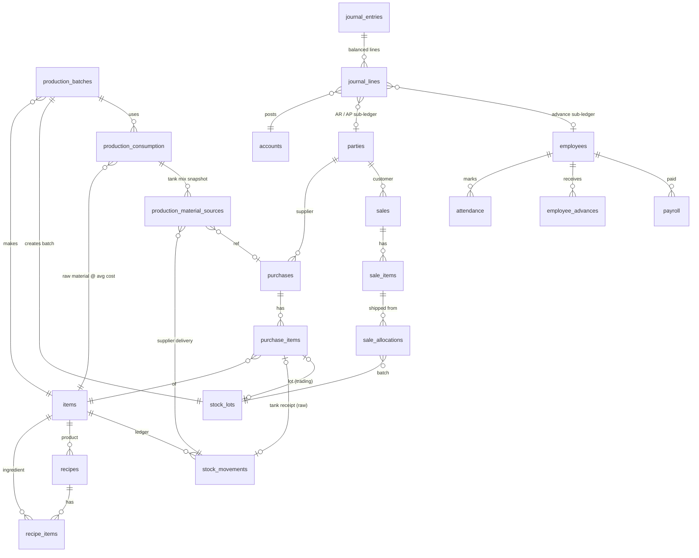

# Soap Factory ERP — Technical Blueprint

## 1. Business rules the system is built around

| Rule | How the system enforces it |
|---|---|
| **Make-to-stock** | Production has no link to sales orders. A batch builds finished-goods stock; invoices are billed only from stock on hand. A sale is refused if stock is short. |
| **Weighted average for raw materials** | Oils and chemicals share tanks, so each raw material has one live balance (`items.stock_qty`, `items.avg_cost`). Each receipt re-averages: `new_avg = (old_qty × old_avg + qty × cost) / (old_qty + qty)`. Each issue leaves at the current average and does not change it. |
| **Batch traceability for finished goods** | Each production run creates one batch (`stock_lots`, code `B2611-001`). Invoices record which batch each unit left from (`sale_allocations`). |
| **Supplier trace through mixed tanks** | When a batch is made, the system replays the tank ledger since the tank was last empty, treating the tank as perfectly mixed (each draw takes the same fraction of every delivery). The share of each supplier delivery is saved in `production_material_sources`. This is an estimate, labelled as one in the UI, and the only honest answer for a blended tank. |
| **One set of books** | Every money event posts one balanced double-entry journal entry. Ledgers, the cash book, P&L and the trial balance are all queries over `journal_lines`, so they cannot drift apart. |
| **Nothing is deleted** | Mistakes are *cancelled*: stock goes back to where it came from and a mirror journal entry is posted. History and the audit log stay intact. |

## 2. Tech stack

| Layer | Choice | Why |
|---|---|---|
| Frontend | React 18 + Vite + React Router, plain CSS design tokens, lucide icons | Fast on cheap Android tablets (~91 KB gzipped JS), no UI framework lock-in |
| Backend | Node.js 20 + Express 4 | One language end to end; small and well understood |
| Database | SQLite (better-sqlite3, WAL mode) | Zero admin, one file to back up, ACID transactions, comfortably handles one factory. The schema is portable to PostgreSQL (see §7). |
| Auth | Session cookie (httpOnly, SameSite=Lax), scrypt password hashes, 3 roles | No external identity service needed on a factory LAN |
| Deployment | **One process, one port**: Express serves the API and the built React app | Runs on a single office PC or a $5 VPS; tablets and phones connect over Wi-Fi |

```
 Tablets / phones / office PC  ──Wi-Fi──►  Node.js (Express)  ──►  SQLite file (data/factory.db)
        React SPA (static)                  /api/* JSON              WAL journal, daily backup
```

## 3. Module map

```
server/src
├── schema.sql          DDL (tables, checks, indexes)
├── db.js               connection, bootstrap (chart of accounts, admin user), helpers
├── auth.js             scrypt hashing, sessions, role middleware
├── accounting.js       post() balanced journal, reverseRef(), balances
├── inventory.js        weighted-average engine, batch engine, tank composition
└── routes/
    ├── items.js        items, stock adjustments, recipes (BOM)
    ├── production.js   preview + record batch, cancel
    ├── trade.js        purchases, sales/invoices, customers & suppliers, payments
    ├── finance.js      cash book, dashboard, P&L, trial balance, day book, stock valuation
    ├── trace.js        batch history (backward), purchase recall (forward), search
    └── hr.js           employees, attendance, advances/loans, payroll
client/src
├── lib.jsx             API client, auth/toast context, money/date formatting
├── components.jsx      PageHead, DataTable (inline search, cards on phones), Picker, Modal…
└── pages/              Dashboard, Stock, Production, Sales, Purchases, Parties, Cash, Reports, Staff, Trace, Settings
```

## 4. Entity-relationship design



Integrity: foreign keys on; `CHECK` constraints on quantities, statuses and debit/credit ≥ 0; `UNIQUE` on document numbers, `(employee_id, date)` for attendance, `(employee_id, month)` for payroll, and `(recipe_id, item_id)` for recipes. Every multi-table write runs in one SQLite transaction, so a failure part-way leaves nothing behind.

### The traceability chain (one query path per hop)

```
Customer ◄─ sales ◄─ sale_items ◄─ sale_allocations ─► stock_lots (batch B2611-001)
                                                          │ source_id
                                                          ▼
                                             production_batches ─► production_consumption (Palm Oil 60 kg @ Rs 440.39)
                                                                          │
                                                                          ▼
                                                    production_material_sources (58% PUR-00006, 42% PUR-00001)
                                                                          │
                                                                          ▼
                                                              purchases ─► Supplier
```
`GET /api/trace/lot/:id` walks this backward; `GET /api/trace/purchase/:id` walks it forward (recall: "which customers got soap containing this delivery?").

## 5. Automatic accounting entries

| Event | Debit | Credit |
|---|---|---|
| Purchase (raw / trading) | Raw Material Stock / Finished Goods Stock | Suppliers (Payable) *[party]* |
| …paid now | Suppliers (Payable) | Cash / Bank |
| Production batch | Finished Goods Stock (materials + other cost) | Raw Material Stock; Overhead Charged to Production |
| Sale | Customers (Receivable) *[party]*; Cost of Goods Sold | Sales; Finished Goods Stock |
| …received now | Cash / Bank | Customers (Receivable) |
| Customer payment | Cash / Bank | Customers (Receivable) |
| Supplier payment | Suppliers (Payable) | Cash / Bank |
| Expense voucher (Expenses page, or Cash Book → Cash Out) | Expense category | Cash / Bank |
| Cash in | Cash / Bank | Other Income / Owner's Capital |
| Advance / loan | Employee Advances *[employee]* | Cash / Bank |
| Salary paid within its month | Salaries (basic + bonus); Overtime Wages | Employee Advances (deduction); Cash / Bank (net) |
| Salary paid after month-end | on the month's last day: Salaries; Overtime Wages | Employee Advances; **Salaries Payable** |
| …then on the payment day | Salaries Payable | Cash / Bank |
| Stock loss | Stock Loss / Wastage | Stock account |
| Any cancellation | mirror image of the original entries | |

"Overhead Charged to Production" is a contra-expense: labour or power charged to a batch moves out of expenses and into stock value, then reaches P&L as Cost of Goods Sold when the soap is sold (absorption costing, so nothing is counted twice).

### Item categories

`item_categories` holds a separate list for each item type (`kind` = raw / finished / trading), managed under **Stock → Categories** or with **+ New category** inside the Add item form. `items.category_id` points to it, and `items.category` keeps a text copy of the name. Renaming updates every item in the category. Hiding (`active = 0`) removes it from the form but items already in it keep it. The stock list can be filtered by category (`GET /api/items?kind=&category_id=`). Starter lists: raw — Oil, Chemical, Fragrance, Colour, Packaging, Other; finished — Soap, Other; trading — Ready-made Goods, Other. Migration v5 moved existing items into categories with the same names.

### Selling raw materials

Raw materials can go on a sales invoice next to soap and trading items. A raw line leaves the tank at the current weighted average cost (`issueAvg`, movement type `sale`, customer stored on the movement). The cost is posted as Dr COGS 5000 / Cr Raw Material Stock 1200, while goods lines credit 1210. The supplier mix of the tank at that moment is saved in `sale_material_sources`, so a supplier purchase's forward trace (`direct_sales`) and the recall list include the customers who bought the material directly. Cancelling the invoice puts the material back into the tank at the cost it left with (`receiveAvg`, type `sale_cancel`).

### Deleting stock items

Deleting never erases an item. `POST /api/items/:id/delete` requires `{ confirm: "DELETE" }` and sets `active = 0` plus `deleted_at` and `deleted_by` (migration v6). It also hides the product's own recipes and is audited.
- **Blocked** while stock is not zero (adjust or sell it first, so the books stay right) and while the item is an ingredient of an active recipe. `GET /api/items/:id/delete-check` lists the blockers and where the item appears.
- **Hidden** from stock lists, pickers and recipes. `assertUsable()` refuses it on new sales, purchases, adjustments, edits, recipes and production.
- **Kept** on every invoice, purchase, batch, ledger, trace and report. A past year's stock list still includes it when it held stock on that date.
- **Restore** with `POST /api/items/:id/restore`. Deleted items are listed at `GET /api/items-deleted?kind=` (Stock → Deleted items).

### Expenses & Profit and Loss

**Expense categories** are expense accounts with `is_expense_category = 1`. Managers can add, rename and hide them (`accounts.active`); hidden categories disappear from the form but stay in reports. Defaults: Electricity & Gas, Rent, Transport & Freight, Repairs & Maintenance, Office & Miscellaneous, Food & Tea, Miscellaneous.

**Expense register** (`expenses` table): one voucher per expense (`EXP-00001`) holding date, category, amount, Cash/Bank, paid to, bill no. and note. Each voucher owns exactly one journal entry (`ref_type = 'expense'`). Editing re-posts it; deleting removes it (status `deleted`, kept in the audit log). The cash book and P&L read the journal, so they update instantly. `GET /api/expenses` filters by month or date range, category, Cash/Bank and text, and returns totals by category, by day and by payment mode, plus the previous period's total.

**Profit & Loss** (`GET /api/reports/pnl`, `GET /api/finance/overview`):
```
  Gross revenue            Sales (4000)
− Cost of goods sold       COGS (5000): cost of the units SOLD
= Gross profit
− Operational expenses     every other expense account: custom categories, stock loss, overhead moved into batches
− Payroll                  5100 Salaries & Wages (split monthly / daily via the payslip) + 5110 Overtime
+ Other income             4900 …
= Net profit / loss
```
Every expense account falls into exactly one section, so net profit always equals income − expenses in the trial balance (covered by a test).

*Why COGS is "cost of soap sold", not "raw material consumed in production":* this is a make-to-stock factory. Material consumed into soap still in the warehouse is an asset (finished-goods stock), not a cost of this month. Counting it at production time would show a false loss in months spent building stock and a false profit in months spent selling it. Each sold unit carries its batch's weighted-average material cost (plus any labour charged to the batch), so COGS still comes from weighted-average raw-material costs. It is just timed to the sale. The statement also shows "raw materials used in production this period" as a memo line.

### Payment methods & multi-account cash/bank

**Fund accounts** are rows in `accounts` with `is_cash = 1` and `fund_type` = `cash` (cash in hand, petty cash, …) or `bank` (one row per bank account, with `bank_name` and `account_number`). Managers add accounts (with an optional opening balance), rename them, and close them once the balance is zero, all from **Cash & Bank**.

**Every money touchpoint takes the same payment fields:**
```
payment_method: cash | bank_transfer | cheque     (default cash)
account_id:     the cash box / bank account       (default: first open account of the right type)
cheque_no, cheque_date, bank_name                 (cheque, optional)
reference                                         (bank transfer / cheque, optional)
```
`resolveFund()` in `accounting.js` validates them: cash must use a cash account, and bank transfers and cheques must use a bank account. It is used by sales, purchases, customer/supplier payments, expenses, salary payouts (single and "pay all"), advances/loans and Money in/out.

**The fund ledger, `fund_transactions`, is written inside `post()`.** Any journal line on a fund account automatically gets a row with direction, amount, method, reference/cheque details, party or employee, purpose (`ref_type`) and cheque status. Rows cascade-delete with their journal entry, and reversals copy the original method and point back to it (`reverses_id`). So `SUM(in − out)` per account always equals that account's balance in the books, which is tested for every account after each kind of transaction. Existing history was backfilled by migration v3.

| Event | Cash & bank effect |
|---|---|
| Cash sale / cash expense / cash salary | Cash-in-hand account up / down instantly |
| Bank transfer or cheque | The **selected** bank account up / down instantly |
| Cheque | Recorded as *not cleared*. **Cleared** stamps the clearing date. **Bounced** (customer/supplier cheques) posts a reversal: the bank goes back, the party owes again, and the invoice/bill `paid` is reduced |
| Internal transfer | One entry Dr destination / Cr source (`method = transfer`). Cannot move more than the source holds on that date. Excluded from "money in/out today" |
| Opening balance of a new account | Dr account / Cr Opening Balances (`method = opening`) |

**Filtering by payment method:** `GET /api/sales`, `/api/purchases` (`?method=cash|bank_transfer|cheque|credit`, with totals by method), `/api/expenses?method=`, `/api/reports/journal?method=` (Day Book), `/api/funds/transactions?method=&direction=&account_id=` (account statement with running balance), and `/api/reports/payment-methods` (money in/out by method × purpose and by account).

### Financial years, year-end closing & carry-forward

**Design: one continuous ledger, years as locked date ranges.** Splitting the books into a separate copy per year would break batch traceability (made in June, sold in July), cheques that clear after year-end, and would double-count balances. The model used by Tally, Odoo and ERPNext applies instead:

| Piece | What it does |
|---|---|
| `financial_years` | name, start/end date, `status` open/closed, closing entry, net profit, closing summary. Shown as **Active** (contains today), **Upcoming**, **Ended — not closed yet**, or **Closed / Locked** |
| `fiscal_year_id` | on `journal_entries`, `fund_transactions`, `stock_movements`, `production_batches`, `purchases`, `sales`, `expenses`, `attendance`, `employee_advances`, `payroll`. **Stamped by triggers** from each row's date (payroll: its month), so it can never be wrong |
| Lock triggers (`fy_lock_*`) | the database rejects INSERT / UPDATE (of accounting columns) / DELETE dated in a closed year: raise `FY_CLOSED`, shown to users as a plain message. Still allowed: marking an old cheque cleared or bounced, and the running "paid" figure of an old invoice |
| Coverage trigger | every journal entry must fall inside a defined year (`FY_MISSING`) |
| App-level checks | `assertOpenDate()` in `post()` and on every create / edit / cancel / delete gives a friendly message naming the year before the database has to step in |
| `fiscal_year_balances` | the **opening-balance ledger**: written at closing for the new year — every GL account (Dr−Cr), customer & supplier (owed), cash/bank account, item (qty × weighted-average cost = value) and finished-goods batch |
| `3200 Retained Earnings` | receives each closed year's net profit or loss |

**Closing (`POST /api/financial-years/:id/close`, one transaction):**
1. Checks. *Blockers:* the year hasn't ended yet; an earlier year is still open; unpaid draft salary slips in the year; trial balance not balancing. *Warnings:* uncleared cheques, negative cash or stock, stock register ≠ books.
2. Closing position on the last day: GL balances, party balances, fund balances, and stock from the movement ledger (`SUM(qty)`, `SUM(value)` up to the last day, so it is exact even when the next year already has entries).
3. Closing entry dated the last day (`ref_type = 'year_close'`): Dr every income account, Cr every expense account, net to Retained Earnings.
4. Snapshot saved as the next year's opening balances. The next year is created automatically if it doesn't exist.
5. Status → closed (triggers now lock it).

Profit reports ignore `year_close` entries, so a closed year's P&L stays readable. The trial balance on the closing date shows pre-closing figures. **Balance Sheet** (`/api/reports/balance-sheet`): assets = liabilities + equity, with "profit of the year (not closed yet)" for open years. `GET /financial-years/:id/opening-balances` re-checks every carried-forward figure against the books on the year's first day. **Reopen** (admin, newest closed year only) removes the closing entry and the snapshot.

**Year switcher:** the client sends `X-Fiscal-Year`. The `fyContext` middleware sets `req.fy` and `req.asOf` (today clamped to the year), which scope dashboards, balances (as of the year's last day for past years), ledgers with an "opening balance brought forward" line, stock history with its brought-forward quantity, production lists and report defaults. Viewing a closed year is read-only: the client hides write actions and refuses writes, the middleware returns 403, and the triggers back both up.

## 6. HR & payroll rules

### Employment types
| | **Monthly Salaried** (`salary_type = 'monthly'`) | **Daily Wager** (`salary_type = 'daily'`) |
|---|---|---|
| Pay field (`salary_amount`) | Fixed monthly salary | Per-day wage rate |
| Attendance buttons | Present · Absent · Half day · Leave | Present · Absent · Half day (no Leave) |
| Basic pay | Full salary. If *"Cut salary for absent days"* is on: `salary ÷ days in month × (days − absent − ½·half days − leave above allowance)` | `(present + ½·half days) × daily rate`. Absent, leave and unmarked days earn nothing |
| Overtime | Off by default (opt in per employee) | On by default |

Days before the joining date are never paid.

### Overtime
* **Factory rules** (Staff → Monthly Payroll → *Change rules*): shift start/end (default 8:00 AM–5:00 PM), weekly off day, **factory standard overtime rate per hour**, paid leaves per month, and whether monthly staff lose pay for absences.
* **Per employee:** `overtime_eligible` and an optional own `overtime_rate`. When the rate is empty, the factory standard rate applies.
* **Recording:** overtime hours are entered per day on the attendance screen (½-hour steps, shown as "left at 6:30 PM"). They are stored in `attendance.overtime_hours`.
* **Validation (server side):** overtime only on a *Present* day, only for eligible staff, and at most `24 − shift hours` (capped at 16) per day. Leave is refused for daily wagers. A paid month is locked.
* **Pay:** `overtime pay = Σ overtime hours × rate`. It is posted to its own expense account, **5110 Overtime Wages**, so P&L shows it separately.

### Month-end formula
```
Daily wager:   (days worked × daily rate) + (overtime hours × overtime rate) + bonus − advance/loan cut = net payable
Monthly:       basic pay (as above)       + (overtime hours × overtime rate) + bonus − advance/loan cut = net payable
```
*Generate Monthly Payroll* creates or refreshes a draft slip for every active employee (paid slips are never changed). Each slip snapshots attendance counts, working days, unmarked working days, basic pay, overtime hours × rate, the advance balance owed, and the suggested deduction. Unmarked working days and overtime without a rate are flagged before payment.

### Advance & loan recovery
Past recoveries are matched to advances oldest first. An *advance* is recovered in full; a *loan* recovers its monthly installment. The amount can be overridden per slip and is capped at the salary.

### Payment entry
`Dr Salaries & Wages (basic + bonus) · Dr Overtime Wages (overtime) · Cr Employee Advances (deduction) · Cr Cash/Bank (net)`

### Schema changes (migration v1, applied automatically on start)
| Table | New columns |
|---|---|
| `employees` | `overtime_eligible INTEGER` (set to 1 for existing daily wagers), `overtime_rate REAL NULL` |
| `attendance` | `overtime_hours REAL CHECK 0–16` |
| `payroll` | `salary_type`, `working_days`, `basic_pay`, `overtime_hours`, `overtime_rate`, `overtime_pay`, `advance_outstanding` |
| `settings` | `shift_start`, `shift_end`, `weekly_off_day`, `overtime_rate_per_hour`, `monthly_deduct_absent` |
| `accounts` | `5110 Overtime Wages` |

Migrations live in `server/src/db.js` (`MIGRATIONS`, tracked with `PRAGMA user_version`). Each step checks before altering, so fresh installs and upgrades end up identical.

## 7. Moving to PostgreSQL (multi-site or > ~20 concurrent users)

1. `INTEGER PRIMARY KEY` → `BIGINT GENERATED ALWAYS AS IDENTITY`; money `REAL` → `NUMERIC(14,2)`; quantities → `NUMERIC(14,3)`; costs → `NUMERIC(18,6)`.
2. Create `parties`, `employees` and `purchases` before the tables that reference them (SQLite allows forward references).
3. Replace `better-sqlite3` calls with `pg` and wrap `tx()` in `BEGIN … COMMIT`. Add `SELECT … FOR UPDATE` on `items` / `stock_lots` rows in `issueAvg` / `consumeLots` to serialise concurrent stock draws.
4. `RETURNING`, `ON CONFLICT` and partial indexes carry over unchanged.

## 8. Responsive & usability guidelines (implemented in `styles.css`)

| Breakpoint | Layout |
|---|---|
| **> 900 px** (PC, landscape tablet) | Fixed left sidebar with grouped menu; 4-column stat grid; tables as tables |
| **641–900 px** (portrait tablet) | Sidebar becomes a **bottom bar** (Home · Stock · Make · Sell · More); "More" opens a grid of large tiles |
| **≤ 640 px** (phone) | Single-column forms; **tables turn into stacked cards** (each cell shows its column name); modals slide up as bottom sheets; 16px gutters, no horizontal page scroll |
| **Print** | Navigation hidden; invoices, payslips, statements and reports print on A4; "Save as PDF" from the print dialog |

Usability rules applied throughout:
* Touch targets ≥ 52 px (attendance buttons 56 px), base text 17 px, inputs 18 px (stops iOS zooming in).
* Every icon has a word next to it. Plain language replaces accounting terms in staff screens ("They owe us", "Received", "Used in production").
* One primary (green) action per screen. Destructive actions are grey until confirmed in a dialog with "No, go back" / "Yes, cancel invoice".
* Searchable pickers replace long dropdowns; every list has inline search.
* Validation happens before saving: "Not enough raw material" is shown per line during production, and short stock turns sale lines red.
* High-contrast palette (text #0f172a on white, AA+). Status is never shown by colour alone (badge text plus icon). Visible amber focus ring for keyboard users.
* Staff see quantities but not money: cost and price fields are removed **on the server**, not just hidden in the UI.

## 9. Security & operations

* Roles: **staff** (stock, production, sales entry, attendance) · **manager** (adds purchases, money, payroll, reports) · **admin** (adds users, settings, backup).
* scrypt password hashing, httpOnly session cookies (7 days), login rate limit (10 tries / 5 min / IP), security headers, parameterised SQL everywhere.
* `audit_log` records who created, cancelled or paid what.
* **Backups:** Settings → *Download backup* (online SQLite backup, safe while running). Schedule a nightly copy of `server/data/` as well.
* For internet exposure, put it behind HTTPS (Caddy or nginx) and set `HTTPS=1` so cookies are marked Secure.

## Sales returns (credit notes)

A return is always booked against the invoice the goods were sold on (`POST /sales/:id/returns`, manager only), so it can never return more than was sold: each invoice line shows `returned_qty` and `returnable_qty`.

- **Back to stock**: goods go back into the same batches they were shipped from (`sale_return_allocations`); raw material goes back into its tank at the cost it left with. Traceability stays intact.
- **Damaged**: nothing comes back into stock. The cost is moved from COGS to *Stock Loss / Wastage* (5250), so the P&L shows it as a loss.
- The customer is credited at the invoice rate less their share of the invoice discount. The last return on an invoice takes exactly the rest of the discount, so returning everything credits exactly the invoice total.
- Journal: Dr Sales / Cr Customer; Dr Stock (restocked cost) + Dr Stock Loss (damaged cost) / Cr COGS. Money paid back now: Dr Customer / Cr Cash|Bank.
- Cancelling a return takes the goods back out (refused if they were sold again) and reverses the journal. An invoice with active returns cannot be cancelled until its returns are.
- The invoice's internal profit, the dashboard (daily sales, best-sellers, top customers) and batch traces are all net of returns.
- `sale_returns` is a financial-year table: stamped and locked by the same triggers as invoices.

## Correcting opening stock

Each opening-stock entry (entered with a new item, or with Adjust stock → Add) can be corrected later from the item page: `PUT /items/:id/opening/:movementId` with `{ qty, unit_cost }`. The correction is made on the original entry, on its own date, not as a new adjustment. Its journal entry (`ref_type = 'opening_stock'`, `ref_id` = the stock movement; migration v7 linked older entries) is posted again at the new value.

- **Raw material:** editable only while the tank has not been used after that entry. The tank's running quantity and weighted average are replayed from that point; only receipts follow it, so no production or sale cost changes.
- **Goods batch:** the quantity can always be corrected, but never below what has already left the batch. The price is locked once anything has been sold or used from it, because those sales were costed at that price.
- Entries in a closed financial year, and entries of deleted items, are locked.

## Making a batch (recipe per batch)
The recipe changes from batch to batch, so there is no separate Recipes screen. **Make a batch** asks for the product, then the materials and quantities used *this time*, then how much was made.
- `GET /api/production/start?product_id=` gives the starting list: the ingredients and output of the product's last active batch, or (if never made) its old saved recipe, or nothing. Deleted materials are left out. Staff do not get costs.
- `POST /api/production` with `{ product_id, items: [{ item_id, qty }], qty_produced, other_cost, date, notes }`. Every material must be an active raw material, listed once, and in stock; `qty_produced` is required. The batch is stored with `recipe_id = NULL`, `runs = 1`; its `production_consumption` rows are the recipe of record, and the next batch starts from them.
- `POST /api/production/preview` takes the same body. The older `{ recipe_id, runs }` form still works for both.
- Being an ingredient of an old saved recipe no longer blocks deleting a material; deleting removes it from those recipes.
